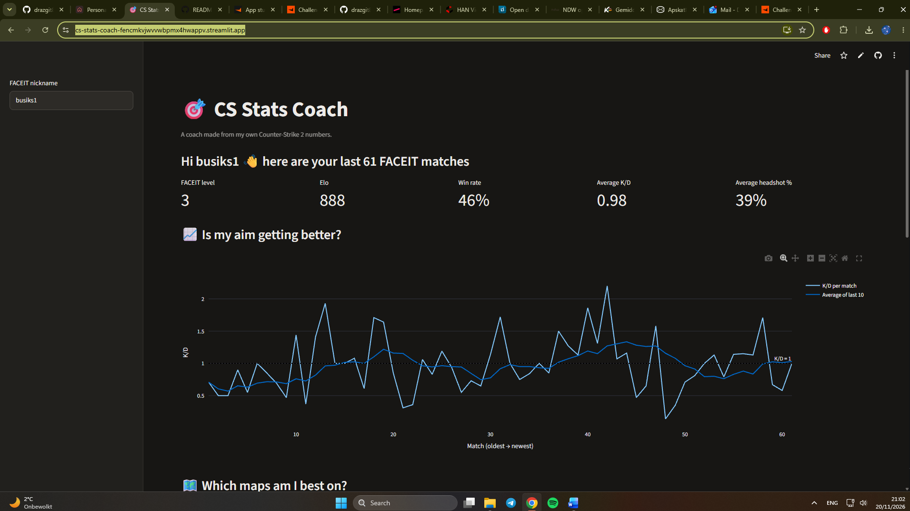

# Process diary

## 2026-11-20: Picking my idea
- **What I did:** Chose my project idea: a "CS stats coach", a dashboard of my own Counter-Strike 2 matches.
- **Why:** I love playing CS2. I play FACEIT and Premier and have about 210 hours in the game, so I have lots of my own data and I actually care what it says. That makes it fun to work on.
- **Video:** "Become a Data Storyteller with Streamlit". Streamlit lets me turn numbers into an interactive story, which fits a coach that explains my stats.
- **Set up:** Created this GitHub repository with a README, this diary, a docs folder and a first empty Streamlit app.
- **Next:** Get a free FACEIT Data API key and connect my match history.

## 2026-11-20: First data on screen
- **What I did:** Got a free FACEIT Data API key and made the app load my last 100 FACEIT matches (nickname busiks1).
- **First version shows:** level, Elo, win rate, K/D, headshot %, K/D over time, win rate per map and a "best map" tip.
- **How the key stays safe:** it is pasted into Streamlit Cloud's Secrets box, never into the code or GitHub.
- **Next:** put the app online on Streamlit Community Cloud and look at what my numbers say.

## 2026-11-20 (evening): Version 1 is online 🎉
- **What I did:** Put the app online on Streamlit Community Cloud and pasted my FACEIT key into the Secrets box.
- **Result:** It loaded my real data: **61 FACEIT matches, level 3, Elo 888, 46% win rate, K/D 0.98, 39% headshots.**
- **What I noticed:** My K/D jumps up and down a lot from match to match, but the 10-match average sits right around 1.0.
- **How I felt:** _[YOUR WORDS: how did it feel to see your own numbers for the first time? Surprised? Proud?]_

## 2026-11-20: Iteration 2 – "Do I play worse late at night?"
- **Question:** Does the time I play change how well I play?
- **What I built:** A new tab **"When I play"** with my win rate per time of day (morning, afternoon, evening, late night), per day of the week, and my average K/D for every hour.
- **How:** FACEIT gives the time each match finished. I changed it to Dutch time and put every match in a "time bucket".
- **Also fixed:** The two lines in the K/D chart had almost the same colour, so the 10-match average is now a thick orange line.
- **Be careful:** if a bar has only 1 or 2 games, it doesn't really mean anything yet. The labels show how many games each bar is based on.
- **What my data says:** _[YOUR WORDS: look at the tab. Do you win less late at night? Is that what you expected?]_

## 2026-11-20: Iteration 3 – "Which teammates help me win?"
- **Question:** Do I win more when I play with certain friends? Is it better to play with friends or alone?
- **What I built:** A **"Teammates"** tab. It shows everyone I played with at least 2 times, how often we won together, and my K/D when they were on my team. It also compares "with a friend" vs "only strangers".
- **How:** The match list from FACEIT doesn't say who was on my team. So for every match, the app asks FACEIT for the match details (the two teams) and finds the team I was on. This is one extra question to FACEIT per match, so the app saves (caches) the answers for a day to stay fast.
- **Be careful:** a friend I played 3 games with could have a 100% win rate by luck. More games = more trustworthy.
- **What my data says:** _[YOUR WORDS: who is your "lucky" teammate? Did you show them? What did they say?]_
